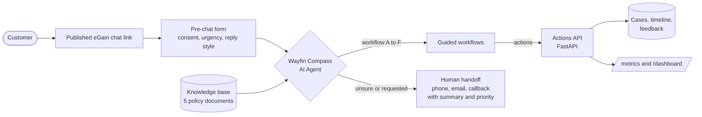

# Architecture

## Request flow for a dispute
1. Customer completes the pre-chat form (issue, urgency, reply style, consent).
2. Compass greets by name, states it is an AI, and starts Workflow A.
3. The customer answers a few button questions; the agent shows the evidence checklist.
4. `POST /disputes` is called with an `Idempotency-Key`. The API returns the case number, priority, provisional-credit flag, and next steps.
5. Compass confirms, offers Workflow F (rating), and ends.
6. The business dashboard updates within seconds.

## Components
| Part | Role | Folder |
|---|---|---|
| Knowledge base | Source of truth for answers | `knowledge/` |
| Agent configuration | Intents, workflows, pre-chat, persona | `agent-config/` |
| Actions API | Creates cases, tracks status, collects feedback, reports metrics | `mock-api/` |
| Tests | 20 automated API tests and a manual agent test plan | `mock-api/test_app.py`, `testing/` |
| CI | Runs tests on every push | `.github/workflows/ci.yml` |
